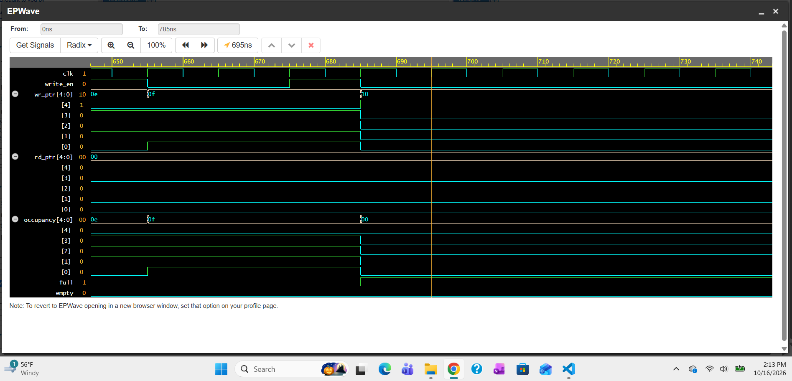
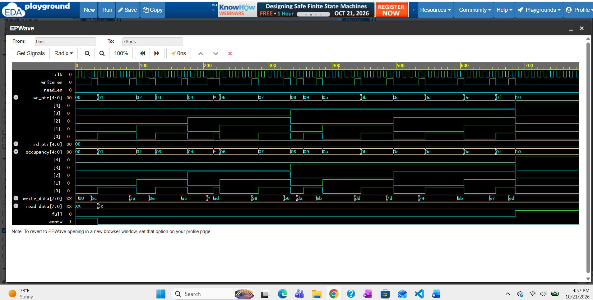
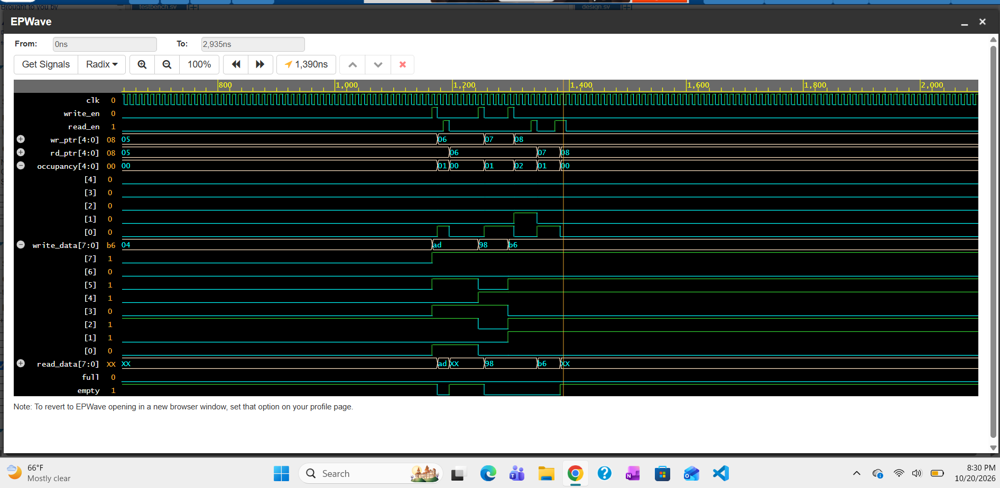
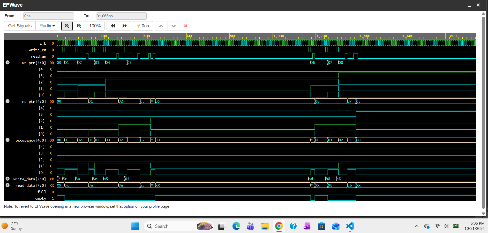

[README (1).md](https://github.com/user-attachments/files/34054946/README.1.md)
# FIFO UVM Verification

UVM verification of a parameterized 16×8 synchronous FIFO, simulated on Synopsys VCS.
The testbench found **4 bugs** — one in the RTL, one in the testbench, and two in the SVA
checkers. Each was root-caused, fixed one at a time, and confirmed by a full regression.
The final regression passes **5 tests, plus the random tests across 3 seeds, with 0 assertion
failures and 0 scoreboard mismatches** (1,500+ random stress operations).

## Highlights

- **Found and fixed an RTL bug:** occupancy reported 0 instead of 16 when the FIFO was full,
  because the calculation ignored the pointer wrap bit. It was caught by 4 SVA assertions and fixed with a one-line change.
- **Found and fixed a testbench race:** the driver checked `full`/`empty` one cycle late,
  causing reads from an empty FIFO and writes to a full one. Caught by assertions and by a
  driver-vs-monitor transaction count mismatch.
- **Found and fixed two checker bugs:** one assertion rejected a legal pointer value, and two
  pointer-progression assertions failed at wraparound because of 32-bit expression sizing.
- **Regression-driven process:** baseline → one fix per round → full 5-test regression after
  each fix → multi-seed random regression.
- **Coverage closure:** write, read, flag, and occupancy coverage at **100%**; operation coverage
  at 91.7% (the remaining gap is documented below).

---

## Design Under Test

Synchronous FIFO (`rtl/design.sv`)

| Parameter | Value |
|---|---|
| Depth | 16 entries |
| Data width | 8 bits |
| Pointers | 5 bits (4 address bits + 1 wrap bit) |
| Read port | Combinational (first-word fall-through) |
| Status outputs | `full`, `empty`, `occupancy[4:0]` |

**Ports:** `clk`, `resetN` (active-low async reset), `write_en`, `write_data[7:0]`, `full`,
`read_en`, `read_data[7:0]`, `empty`, `occupancy[4:0]`

The DUT contains **11 SVA assertions** covering flag exclusivity, protocol rules
(no write when full, no read when empty), pointer progression, occupancy updates,
flag/occupancy consistency, and write-data capture.

---

## Testbench Architecture

```
fifo_test_base
└── fifo_env
    ├── fifo_agent
    │   ├── fifo_sequencer
    │   ├── fifo_driver      (clocking-block driven, flow control with timeout)
    │   └── fifo_monitor     (clocking-block sampled, 5 covergroups)
    └── fifo_scoreboard      (queue-based reference model, in-order data check)

tb_top: clock/reset generation, DUT instance, interface, config_db, run_test()
```

**Data flow**

```
Sequence → Sequencer → Driver → [ fifo_if ] → FIFO DUT
                                     │
                                  Monitor ──(write_ap / read_ap)──► Scoreboard
                                     │
                                 Covergroups
```

| Component | Role |
|---|---|
| `fifo_if` | Interface with driver and monitor clocking blocks |
| `fifo_driver` | Drives write/read transactions; waits up to 20 cycles on full/empty, then skips |
| `fifo_monitor` | Observes accepted writes/reads, publishes them to the scoreboard, samples coverage |
| `fifo_scoreboard` | Pushes observed writes into a queue; compares every read against the expected value |
| Covergroups | Write (address/data), read (address/data), flags (incl. illegal full&empty cross), occupancy levels, operation (write × read cross) |

---

## Verification Plan

| Test | Stimulus | Targets |
|---|---|---|
| `fifo_write_test` | 16 writes | Fill to full, full flag, occupancy 0→16 |
| `fifo_read_test` | 8 writes, then 8 reads | Data ordering, first-word fall-through |
| `fifo_full_drain_test` | 16 writes, then 16 reads | Full boundary, complete drain, pointer wrap of address bits |
| `fifo_mixed_test` | 32 random reads/writes | Random interleaving, empty-boundary behavior |
| `fifo_stress_test` | 500 random reads/writes | Long-run behavior, repeated full/empty, 5-bit pointer wraparound |

Transactions use constrained-random data (8-bit) and random inter-operation delay (0–5 cycles).

---

## Results

### Final regression (after all fixes, default seed)

| Test | End time | Assertion failures | Writes / reads (driver = monitor) | Scoreboard |
|---|---|---|---|---|
| write | 945 ns | **0** | 16 / 0 | — (16 left in FIFO) |
| read | 885 ns | **0** | 8 / 8 | 8 / 8 match |
| full_drain | 1,595 ns | **0** | 16 / 16 | 16 / 16 match |
| mixed | 3,355 ns | **0** | 12 / 11 | 11 / 11 match |
| stress | 36,235 ns | **0** | 221 / 206 | 206 / 206 match |

### Seed regression (random tests)

| Test | Seed | Writes / reads | Skipped W / R | Scoreboard | Failures |
|---|---|---|---|---|---|
| mixed | 1 | 12 / 11 | 0 / 9 | 11 / 11 | 0 |
| mixed | 2 | 22 / 6 | 0 / 4 | 6 / 6 | 0 |
| mixed | 3 | 18 / 12 | 0 / 2 | 12 / 12 | 0 |
| stress | 1 | 221 / 206 | 63 / 10 | 206 / 206 | 0 |
| stress | 2 | 238 / 224 | 14 / 24 | 224 / 224 | 0 |
| stress | 3 | 240 / 236 | 12 / 12 | 236 / 236 | 0 |

Seed 2 drove the mixed test to full for the first time (occupancy coverage 33% → 100%),
exercising the fixed occupancy logic at the boundary.

### Coverage (best across the regression)

| Covergroup | Coverage | Notes |
|---|---|---|
| Write | **100%** | `00`/`FF` data bins first hit by stress seed 3 |
| Read | **100%** | |
| Flag | **100%** | Illegal `full && empty` bin never hit |
| Occupancy | **100%** | `full = 16` bin only reachable after Fix #1 |
| Operation | **91.7%** | Simultaneous read + write bin unreachable (see Known Limitations) |

Coverage is reported per run. These figures are the best result across runs, merged by hand.

---

## Bugs Found

### Bug 1 — RTL: occupancy reads 0 when the FIFO is full

| | |
|---|---|
| **Caught by** | `assert_occupancy_on_write`, `assert_full_occupancy_correlation`, `assert_empty_occupancy_correlation`, `assert_occupancy_on_read` |
| **First failure** | 695 ns in `fifo_write_test` (the 16th write) |
| **Symptom** | `full = 1` and `empty = 0`, but `occupancy = 0` |
| **Root cause** | Occupancy was computed from only the low 4 pointer bits. When the FIFO is full, the low bits of `wr_ptr` and `rd_ptr` are equal, so the result was 0. The wrap bit, which distinguishes full from empty, was ignored. |
| **Fix** | `assign occupancy = wr_ptr - rd_ptr;` (full 5-bit pointers) |
| **Verified** | All occupancy assertions pass. Occupancy coverage 83.3% → 100%. The stress test, which previously aborted, runs to completion. |

Before: at 695 ns, `wr_ptr[4]` (wrap bit) is set and `full` asserts, but `occupancy` reads `00`.


After: `occupancy` reaches `10` (16), with `occupancy[4]` asserting together with `full`.


The read-side assertion failure in `fifo_full_drain_test` was a downstream effect. The value
after the first read was correct (15), but the assertion compared it against the wrong previous
value (0). It disappeared with the root-cause fix, with no separate change.

### Bug 2 — Testbench: driver race on `full` / `empty`

| | |
|---|---|
| **Caught by** | `assert_no_read_when_empty`, `assert_no_write_when_full`, and a **driver vs. monitor count mismatch** (mixed test: driver 12 reads, monitor 11) |
| **First failure** | 1,395 ns in `fifo_mixed_test` |
| **Root cause** | On back-to-back operations, the driver checked the flag on the same clock edge as the previous operation. The clocking block samples values from *before* the edge, so the driver saw the stale flag. A read of the last entry, followed immediately by another read, kept `read_en` high for 2 cycles; the second cycle read an empty FIFO. |
| **Fix** | One idle cycle (`@(vif.cb)`) after each operation, so flags update before the next check |
| **Verified** | Both assertions gone. Driver and monitor counts match in every test. In stress, the 3 illegal writes and 2 illegal reads became correct skips (total operations unchanged at 500), and the monitor's counts were identical to the previous round. |

The DUT handled the illegal read correctly: its read logic is gated by `!empty`, so `rd_ptr` did
not advance and the scoreboard stayed clean.



### Bug 3 — Assertion: `assert_pointer_wraparound` rejects a legal value

| | |
|---|---|
| **Caught by** | 152+ false failures in `fifo_stress_test`, occurring only while a pointer equaled 31 |
| **Root cause** | The check required `ptr < {5{1'b1}}` (i.e., `< 31`). 31 is a legal 5-bit pointer value, and a 5-bit signal cannot hold an out-of-range value, so the assertion could never catch a real bug. |
| **Fix** | Assertion removed |

### Bug 4 — Assertion: pointer-progression checks fail at wraparound

| | |
|---|---|
| **Caught by** | `assert_write_ptr_progression` / `assert_read_ptr_progression` in `fifo_stress_test`, failing once per wrap (failure count = number of 31→0 wraps) |
| **Root cause** | In `$past(wr_ptr) + 1`, the literal `1` is a 32-bit integer, so the sum was evaluated at 32 bits: 31 + 1 = 32 instead of wrapping to 0. |
| **Fix** | `$past(wr_ptr) + 1'b1` — keeps the expression 5 bits wide so it wraps correctly |
| **Verified** | 0 failures across 6–7 wraps per stress run, across 3 seeds |

`wr_ptr` wraps `1F → 00` (legal); occupancy stays correct across the wrap, while both buggy assertions fire.


### Baseline vs. final

| Test | Baseline | Final |
|---|---|---|
| write | 3 assertions failing (Bug 1) | 0 failures |
| read | 0 failures (bug not reached) | 0 failures |
| full_drain | 4 assertions failing (Bug 1) | 0 failures |
| mixed | Read when empty; driver/monitor mismatch (Bug 2) | 0 failures; counts match |
| stress | ~1,100 failures; **aborted at 15.3 µs** (log limit) | 0 failures; runs to completion |

All logs are in [`logs/`](logs/): `*_before_fix.log` (baseline), `*_fix1.log`, `*_fix2.log`,
`*_fix34.log` (one per fix round), and `*_seed2.log` / `*_seed3.log`.

---

## Integration Notes

The original testbench did not compile or run. Before the baseline above, it needed
integration fixes. These were required to run, and are not counted as verification findings:

- Added a top module (clock, reset, DUT instance, `config_db` setup, `run_test()`)
- Removed a duplicate configuration class; fixed an invalid `$cast` call
- Scoreboard now compares read data against expected values (previously it only popped the queue)
- Driver waits on full/empty with a timeout instead of waiting forever
- Monitor samples through a clocking block; coverage samples only on actual operations
- Transaction delay made `rand`; read test fills the FIFO before reading; end-of-test drain time

---

## How to Run

Runs on [EDA Playground](https://www.edaplayground.com) — **EDA Playground link: _add here_**

| Setting | Value |
|---|---|
| Testbench + Design | SystemVerilog/Verilog |
| UVM / OVM | UVM 1.2 |
| Simulator | Synopsys VCS (Riviera-PRO's free license does not support SVA) |
| Files | `rtl/design.sv` → design pane, `testbench/testbench.sv` → testbench pane |
| Run options | `+UVM_TESTNAME=<test>` and optionally `+ntb_random_seed=<n>` |

Tests: `fifo_write_test`, `fifo_read_test`, `fifo_full_drain_test`, `fifo_mixed_test`, `fifo_stress_test`

A run passes when there are no `Error:` lines from `design.sv`, the scoreboard reports
`mismatches: 0`, and the driver and monitor counts match.

---

## Known Limitations & Future Work

- **Simultaneous read/write is not exercised.** The driver issues one operation at a time, so
  the operation-coverage cross bin (write = 1, read = 1) is unreachable (91.7%). Planned: a
  sequence/transaction that drives both enables in the same cycle.
- **Assertion failures are not counted by UVM.** The SVA uses `$error`, so the UVM report shows
  `UVM_ERROR: 0` even when assertions fail. Pass/fail must check the log for `Error:` lines.
  Planned: switch to `` `uvm_error ``.
- **Assertions live inside the RTL.** In production, checkers are usually separate modules
  attached with `bind`.
- **Driver throughput.** The Fix #2 idle cycle prevents back-to-back operations on consecutive cycles.
- **`read_data` is not meaningful when empty** (unwritten or stale entry). This is harmless, but a
  design could hold or zero the output when `empty = 1`.
- **Planned: C++ reference model** connected to the scoreboard through DPI-C.

---

## Repository Structure

```
rtl/design.sv            FIFO RTL with SVA assertions (final, all fixes applied)
testbench/testbench.sv   UVM testbench (interface, components, tests, top)
logs/                    Simulation logs: baseline, each fix round, seed runs
waveforms/               EPWave screenshots: baseline and each fix round
```

## Tools

SystemVerilog · UVM 1.2 · SVA · Synopsys VCS X-2025.06 (via EDA Playground) · EPWave
